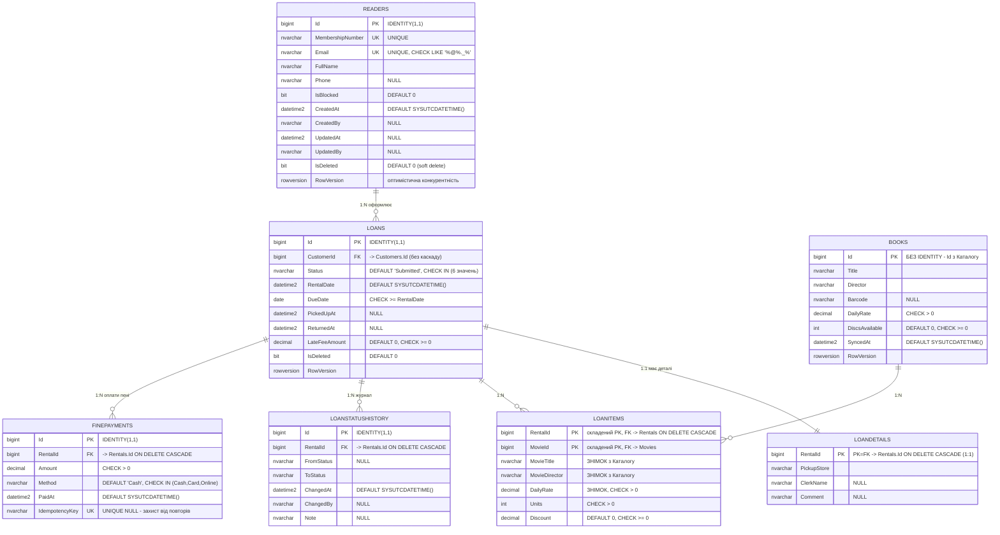
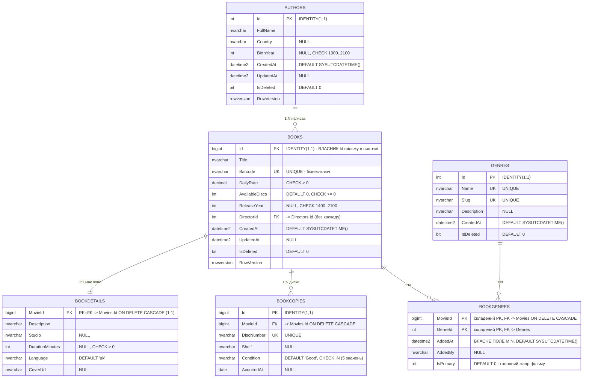
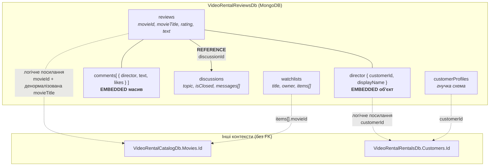

# ERD-діаграми — «Система управління відеопрокатом»

> Лабораторна робота № 01. Діаграми для Проєктів №1 і №2 з ключами, типами
> зв'язків, індексами та обмеженнями. Діаграми у форматі Mermaid рендеряться
> безпосередньо на GitHub; нижче наведено також DSL для dbdiagram.io.

---

## 1. Проєкт №1 — `VideoRentalRentalsDb` (SQL Server + ADO.NET & Dapper)

### 1.1. Mermaid ERD



### 1.2. Три типи зв'язків і розміщення зовнішнього ключа

| Тип | Зв'язок | Де стоїть FK | Реалізація |
|---|---|---|---|
| **1:1** | `Rentals` ↔ `RentalDetails` | у **залежній** таблиці `RentalDetails` | `RentalId` є **одночасно PK і FK** — фізично неможливо мати два рядки деталей на одну оренду |
| **1:N** | `Customers` → `Rentals` | у таблиці на боці **«багатьох»** (`Rentals.CustomerId`) | звичайний FK **без каскаду**: клієнта з історією оренд не видаляємо |
| **M:N** | `Rentals` ↔ `Movies` | у **проміжній** таблиці `RentalItems` | два FK + складений PK `(RentalId, MovieId)` + власні поля (`Units`, `Discount`, знімки) |

### 1.3. Індекси та запити, під які вони створені

| Індекс | Під який запит | Особливість |
|---|---|---|
| `IX_Customers_Active_MembershipNumber` | «знайти клієнта за номером картки» | **фільтрований** `WHERE IsDeleted = 0`, `INCLUDE (FullName, Email)` — покриваючий |
| `IX_Movies_Title` | «пошук фільму за назвою у формі оренди» | `INCLUDE (Director, DailyRate, DiscsAvailable)` — покриваючий |
| `IX_Rentals_CustomerId_Status` | «оренди клієнта з певним статусом» (основний список API) | складений, `INCLUDE (DueDate, LateFeeAmount)` |
| `IX_Rentals_Overdue` | «прострочені оренди» (звіт) | **фільтрований** `WHERE Status='PickedUp' AND IsDeleted=0` |
| `IX_RentalItems_MovieId` | «у яких орендах фігурує цей фільм» | зворотний бік складеного PK |
| `IX_RentalStatusHistory_RentalId_ChangedAt` | «історія однієї оренди в хронологічному порядку» | складений |
| `IX_LateFeePayments_RentalId` | «усі оплати по оренди» | `INCLUDE (Amount, PaidAt)` |

Свідомо **не** індексуємо: `Rentals.RentalDate`, `RentalItems.Units`, `Customers.Phone` —
немає запитів, які б фільтрували за цими стовпцями («сліпе індексування»).

### 1.4. DSL для dbdiagram.io — Проєкт №1

```
// VideoRentalRentalsDb -- вставити на https://dbdiagram.io/d
Table Customers {
  Id bigint [pk, increment]
  MembershipNumber nvarchar(20) [unique, not null]
  Email nvarchar(256) [unique, not null]
  FullName nvarchar(200) [not null]
  Phone nvarchar(30)
  IsBlocked bit [not null, default: 0]
  CreatedAt datetime2 [not null]
  CreatedBy nvarchar(100)
  UpdatedAt datetime2
  UpdatedBy nvarchar(100)
  IsDeleted bit [not null, default: 0]
  RowVersion rowversion
  Indexes {
    MembershipNumber [name: 'IX_Customers_Active_MembershipNumber', note: 'filtered: IsDeleted = 0']
  }
}

Table Movies {
  Id bigint [pk, note: 'NO identity -- Id comes from VideoRentalCatalogDb']
  Title nvarchar(300) [not null]
  Director nvarchar(200) [not null]
  Barcode nvarchar(20)
  DailyRate decimal(18,2) [not null, note: 'CHECK > 0']
  DiscsAvailable int [not null, default: 0, note: 'CHECK >= 0']
  SyncedAt datetime2 [not null]
  RowVersion rowversion
  Indexes {
    Title [name: 'IX_Movies_Title']
  }
}

Table Rentals {
  Id bigint [pk, increment]
  CustomerId bigint [not null]
  Status nvarchar(30) [not null, default: 'Submitted']
  RentalDate datetime2 [not null]
  DueDate date [not null]
  PickedUpAt datetime2
  ReturnedAt datetime2
  LateFeeAmount decimal(18,2) [not null, default: 0]
  CreatedAt datetime2 [not null]
  CreatedBy nvarchar(100)
  UpdatedAt datetime2
  UpdatedBy nvarchar(100)
  IsDeleted bit [not null, default: 0]
  RowVersion rowversion
  Indexes {
    (CustomerId, Status) [name: 'IX_Rentals_CustomerId_Status']
    DueDate [name: 'IX_Rentals_Overdue', note: "filtered: Status='PickedUp'"]
  }
}

Table RentalDetails {
  RentalId bigint [pk, note: '1:1 -- PK is also FK']
  PickupStore nvarchar(100) [not null]
  ClerkName nvarchar(200)
  Comment nvarchar(1000)
}

Table RentalItems {
  RentalId bigint [pk]
  MovieId bigint [pk]
  MovieTitle nvarchar(300) [not null, note: 'SNAPSHOT']
  MovieDirector nvarchar(200) [not null, note: 'SNAPSHOT']
  DailyRate decimal(18,2) [not null, note: 'SNAPSHOT']
  Units int [not null, note: 'CHECK > 0']
  Discount decimal(18,2) [not null, default: 0]
  Indexes {
    MovieId [name: 'IX_RentalItems_MovieId']
  }
}

Table RentalStatusHistory {
  Id bigint [pk, increment]
  RentalId bigint [not null]
  FromStatus nvarchar(30)
  ToStatus nvarchar(30) [not null]
  ChangedAt datetime2 [not null]
  ChangedBy nvarchar(100)
  Note nvarchar(400)
  Indexes {
    (RentalId, ChangedAt) [name: 'IX_RentalStatusHistory_RentalId_ChangedAt']
  }
}

Table LateFeePayments {
  Id bigint [pk, increment]
  RentalId bigint [not null]
  Amount decimal(18,2) [not null, note: 'CHECK > 0']
  Method nvarchar(30) [not null, default: 'Cash']
  PaidAt datetime2 [not null]
  IdempotencyKey nvarchar(64) [unique]
  Indexes {
    RentalId [name: 'IX_LateFeePayments_RentalId']
  }
}

// 1:N
Ref: Rentals.CustomerId > Customers.Id
// 1:1
Ref: RentalDetails.RentalId - Rentals.Id
// M:N through RentalItems
Ref: RentalItems.RentalId > Rentals.Id
Ref: RentalItems.MovieId > Movies.Id
// 1:N
Ref: RentalStatusHistory.RentalId > Rentals.Id
Ref: LateFeePayments.RentalId > Rentals.Id
```

---

## 2. Проєкт №2 — `VideoRentalCatalogDb` (SQL Server + EF Core Code-First)

### 2.1. Mermaid ERD



### 2.2. Три типи зв'язків

| Тип | Зв'язок | Де стоїть FK | Fluent API (Лаб. 03) |
|---|---|---|---|
| **1:1** | `Movies` ↔ `MovieDetails` | `MovieDetails.MovieId` (PK=FK) | `HasOne(b => b.Detail).WithOne().HasForeignKey<MovieDetail>(d => d.MovieId)` |
| **1:N** | `Directors` → `Movies` | `Movies.DirectorId` | `HasOne(b => b.Director).WithMany(a => a.Movies).HasForeignKey(b => b.DirectorId)` |
| **1:N** | `Movies` → `DiscDiscs` | `DiscDiscs.MovieId` | `HasMany(b => b.Discs).WithOne().HasForeignKey(c => c.MovieId).OnDelete(Cascade)` |
| **M:N** | `Movies` ↔ `Genres` | проміжна `MovieGenres` | `HasKey(bg => new { bg.MovieId, bg.GenreId })` + два `HasOne().WithMany()` |

**Чому M:N описано явною сутністю, а не автоматичним M:N EF Core:** проміжна
таблиця `MovieGenres` має **власні поля** `AddedAt`, `AddedBy`, `IsPrimary`.
Автоматичний M:N (`HasMany().WithMany()`) створив би «чисту» таблицю лише з двома
FK і зберегти ці поля не дозволив би. Саме завдяки `AddedAt` працює LINQ-запит
«нові фільми жанру за період» (Лаб. 03, Частина 2.2).

### 2.3. Індекси та запити, під які вони створені

| Індекс | Під який запит | Особливість |
|---|---|---|
| `UQ_Movies_Barcode` | унікальність бізнес-ключа; «фільм за Barcode» | `UNIQUE` → повторне створення дає **409 Conflict** (Лаб. 03) |
| `IX_Movies_Title` | «список фільмів із пошуком за назвою» (пагінація API) | `INCLUDE (DailyRate, AvailableDiscs, DirectorId)` — покриваючий |
| `IX_Movies_DirectorId` | «усі фільми режисера» | під `JOIN` з `Directors` |
| `IX_Movies_Active` | «наявні в каталозі фільму» | **фільтрований** `WHERE IsDeleted = 0` |
| `IX_Directors_FullName` | «пошук режисера за прізвищем» | |
| `UQ_Genres_Name`, `UQ_Genres_Slug` | унікальність жанру; пошук за slug з URL | `UNIQUE` |
| `UQ_DiscDiscs_DiscNumber` | «диск за інвентарним номером» | `UNIQUE` |
| `IX_DiscDiscs_MovieId` | «усі диски фільму зі станом» | `INCLUDE (Condition, Shelf)` |
| `IX_MovieGenres_GenreId_AddedAt` | **«нові фільми жанру за період»** — LINQ-запит через проміжну сутність | складений, `AddedAt DESC`, `INCLUDE (MovieId)` |

### 2.4. DSL для dbdiagram.io — Проєкт №2

```
// VideoRentalCatalogDb -- вставити на https://dbdiagram.io/d
Table Directors {
  Id int [pk, increment]
  FullName nvarchar(200) [not null]
  Country nvarchar(100)
  BirthYear int [note: 'CHECK 1000..2100']
  CreatedAt datetime2 [not null]
  UpdatedAt datetime2
  IsDeleted bit [not null, default: 0]
  RowVersion rowversion
  Indexes {
    FullName [name: 'IX_Directors_FullName']
  }
}

Table Genres {
  Id int [pk, increment]
  Name nvarchar(100) [unique, not null]
  Slug nvarchar(100) [unique, not null]
  Description nvarchar(500)
  CreatedAt datetime2 [not null]
  IsDeleted bit [not null, default: 0]
}

Table Movies {
  Id bigint [pk, increment, note: 'OWNER of movie identity across all 3 databases']
  Title nvarchar(300) [not null]
  Barcode nvarchar(20) [unique, not null]
  DailyRate decimal(18,2) [not null, note: 'CHECK > 0']
  AvailableDiscs int [not null, default: 0, note: 'CHECK >= 0']
  ReleaseYear int [note: 'CHECK 1400..2100']
  DirectorId int [not null]
  CreatedAt datetime2 [not null]
  UpdatedAt datetime2
  IsDeleted bit [not null, default: 0]
  RowVersion rowversion
  Indexes {
    Title [name: 'IX_Movies_Title']
    DirectorId [name: 'IX_Movies_DirectorId']
  }
}

Table MovieDetails {
  MovieId bigint [pk, note: '1:1 -- PK is also FK']
  Description nvarchar(2000) [not null]
  Studio nvarchar(200)
  DurationMinutes int [note: 'CHECK > 0']
  Language nvarchar(50) [not null, default: 'uk']
  CoverUrl nvarchar(500)
}

Table DiscDiscs {
  Id bigint [pk, increment]
  MovieId bigint [not null]
  DiscNumber nvarchar(40) [unique, not null]
  Shelf nvarchar(40)
  Condition nvarchar(20) [not null, default: 'Good']
  AcquiredAt date
  Indexes {
    MovieId [name: 'IX_DiscDiscs_MovieId']
  }
}

Table MovieGenres {
  MovieId bigint [pk]
  GenreId int [pk]
  AddedAt datetime2 [not null, note: 'OWN FIELD of the M:N junction']
  AddedBy nvarchar(100)
  IsPrimary bit [not null, default: 0]
  Indexes {
    (GenreId, AddedAt) [name: 'IX_MovieGenres_GenreId_AddedAt']
  }
}

// 1:N
Ref: Movies.DirectorId > Directors.Id
// 1:1
Ref: MovieDetails.MovieId - Movies.Id
// 1:N
Ref: DiscDiscs.MovieId > Movies.Id
// M:N through MovieGenres
Ref: MovieGenres.MovieId > Movies.Id
Ref: MovieGenres.GenreId > Genres.Id
```

---

## 3. Проєкт №3 — `VideoRentalReviewsDb` (MongoDB): структура колекцій

MongoDB — не реляційна СУБД, тому замість ERD наводимо **карту колекцій**
із позначенням способу моделювання зв'язків.



| Колекція | Спосіб моделювання | Що демонструє |
|---|---|---|
| `reviews` | **ГІБРИД** | вбудований об'єкт `director`, вбудований масив `comments[]`, **посилання** `discussionId`, денормалізована `movieTitle`, різні набори полів (`photos`, `tags`, `ratings{}`, `watchingContext{}`) |
| `discussions` | **referencing** (цільова колекція) | винесена окремо саме тому, що `messages[]` зростає **необмежено** — вбудувати тисячі повідомлень у відгук не можна (ліміт документа 16 МБ + постійне перезаписування) |
| `watchlists` | **embedding** | `items[]` завжди читаються разом із підбіркою і їх небагато → вбудовування |
| `customerProfiles` | **гнучка схема** | три документи з принципово різними полями: `badges`+`stats`+`preferences` / `socialLinks`+`stats` / лише обов'язкові поля |

### Правило вибору embedding vs referencing у цьому проєкті

| Критерій | `comments` → **embed** | `discussion.messages` → **reference** |
|---|---|---|
| Чи читаються разом з батьком? | так, завжди | ні, лише за запитом |
| Чи обмежена кількість? | так, кілька останніх | **ні, необмежена** |
| Хто редагує? | лише в межах відгуку | окрема ветка зі своїм життєвим циклом |

### Індекси MongoDB

| Індекс | Під який запит | Тип |
|---|---|---|
| `ix_reviews_movie_created` `{movieId:1, createdAt:-1}` | «усі відгуки на фільм, найновіші спочатку» | складений |
| `ix_reviews_movie_rating` `{movieId:1, rating:-1}` | «середній рейтинг і розподіл оцінок» (aggregation) | складений |
| `ix_reviews_customer` `{"director.customerId":1}` | «усі відгуки клієнта» | **sparse** — `customerId` є не в усіх документах (анонімні відгуки) |
| `ix_reviews_fulltext` `{text:"text", movieTitle:"text"}` | повнотекстовий пошук | text |
| `ix_reviews_with_photos` `{createdAt:-1}` | «відгуки з фото» | **partial** `{photos:{$exists:true}}` |
| `ix_discussions_movie_open` `{movieId:1, isClosed:1}` | «відкриті обговорення фільму» | складений |
| `ix_lists_item_movie` `{"items.movieId":1, isPublic:1}` | «публічні підбірки з конкретним фільмом» | **multikey** по вбудованому масиву |
| `ix_profiles_customer` `{customerId:1}` | профіль клієнта | **unique** |

Перевірка використання індексу — `03-queries.js`, блок 11 (`explain()` показує
`IXSCAN`, а не `COLLSCAN`).
